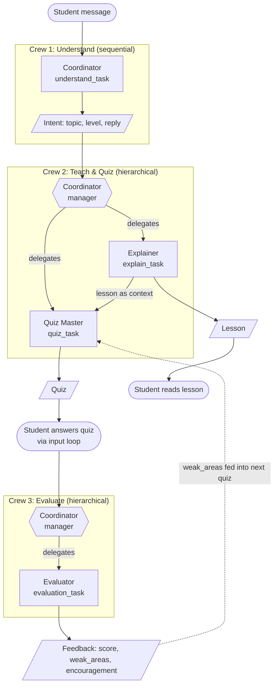

# LeoAgent: Multi-Agent Study Tutor

LeoAgent is a multi-agent tutor built with [CrewAI](https://github.com/crewAIInc/crewAI). A student says what they want to learn. The agents then teach a short lesson, write a quiz, collect the student's answers and grade them with feedback.

The LLM is `gpt-oss-20b`, served through Groq's OpenAI-compatible API.

## Agents and their roles

| Agent | Role | Delegates? | Task(s) | Output |
|---|---|---|---|---|
| **Coordinator** | Study session coordinator. Works out what the student wants, hands work to the right teammate and checks quality. | Yes | `understand_task`, and acts as **manager** of the other crews | `Intent` (topic, level, reply) |
| **Explainer** | Empathetic teacher. Teaches the topic at the student's level with simple examples. | No | `explain_task` | Lesson (Markdown, under 250 words) |
| **Quiz Master** | Writes 3–5 practice questions (mostly MCQ plus one short answer), each tagged with a concept, and targets past weak areas. | No | `quiz_task` (uses the lesson as context) | `Quiz` (list of `Question`) |
| **Evaluator** | Kind but honest examiner. Gives 1 / 0.5 / 0 per question, explains each mistake and lists weak areas. | No | `evaluation_task` | `Feedback` (score, per-question results, weak areas, encouragement) |

All structured outputs are Pydantic models (`Intent`, `Question`, `Quiz`, `QuestionResult`, `Feedback`), so each stage passes typed data to the next.

## Architecture



ASCII version:

```
Student msg ─► [Crew 1 · sequential]  Coordinator ──► Intent(topic, level)
                                                          │
               [Crew 2 · hierarchical] Coordinator (manager)
                                         ├─► Explainer ──► Lesson ──┐
                                         └─► Quiz Master ◄──────────┘ (context)
                                                          │
                                                        Quiz ─► Student answers
                                                                     │
               [Crew 3 · hierarchical] Coordinator (manager)
                                         └─► Evaluator ──► Feedback
                                                              │
                                     weak_areas ─────────────┘ (fed into next quiz)
```

## Orchestration pattern

LeoAgent uses a **pipeline of crews** with a **hierarchical manager–worker** pattern inside the later stages:

1. **Sequential routing (Crew 1).** The Coordinator classifies the student's message as one of `learn`, `clarify`, `smalltalk` or `quit`, and returns a structured `Intent`. This is the router or front door.
2. **Hierarchical delegation (Crews 2 and 3).** The Coordinator is the `manager_agent` (`Process.hierarchical`). It does not do the work itself. It delegates to specialist workers (Explainer, Quiz Master, Evaluator), reviews what they produce and can ask for fixes.
3. **Context chaining.** `quiz_task` has `context=[explain_task]`, so the quiz only asks about what the lesson actually taught.
4. **Human in the loop.** Between Crew 2 and Crew 3 the program pauses and collects the student's answers with `input()`.
5. **Feedback loop.** The Evaluator's `weak_areas` can go back into the next `quiz_task` through the `{weak_areas}` input, so later quizzes focus on what the student got wrong.
6. **Structured outputs.** Every hand-off uses `output_pydantic`, so data passes between stages as validated objects instead of free text.

## How to run

### Option A: Google Colab (as written)

1. Open `LeoAgent.ipynb` in Colab.
2. Add a secret named `GROQ_API_KEY` (key icon in the left sidebar) and enable notebook access. Get a key at <https://console.groq.com>.
3. Run all cells. When the quiz cell runs, type your answers (an option number for MCQs, free text for short answers).

### Option B: Local

```bash
git clone <this-repo-url>
cd <repo>
python -m venv .venv
source .venv/bin/activate        # Windows: .venv\Scripts\activate
pip install -r requirements.txt
```

Set your key as an environment variable. Do **not** put it in the notebook:

```bash
export GROQ_API_KEY="your-key"           # macOS/Linux
$env:GROQ_API_KEY = "your-key"           # Windows PowerShell
```

In the setup cell, replace the Colab-only lines:

```python
from google.colab import userdata
os.environ["GROQ_API_KEY"] = userdata.get('GROQ_API_KEY')
```

with:

```python
import os
assert os.environ.get("GROQ_API_KEY"), "Set GROQ_API_KEY first"
```

Then start Jupyter and run the cells in order:

```bash
jupyter notebook LeoAgent.ipynb
```

### Notes

- `memory=True` on Crew 2 turns on CrewAI memory, which uses an embedding model. By default that is OpenAI's, so it needs `OPENAI_API_KEY`. Either set that key, configure a different `embedder` on the crew, or set `memory=False`.
- The notebook uses top-level `await crew.kickoff_async(...)`. That works in Jupyter/Colab. In a plain `.py` script, use `crew.kickoff(...)` or wrap the calls in `asyncio.run(...)`.

## Security

No API keys are committed. The key is read at runtime from Colab secrets or an environment variable. If you use a `.env` file, add it to `.gitignore`.

## Project structure

```
.
├── LeoAgent.ipynb     # agents, tasks, Pydantic schemas and the full run
├── requirements.txt
└── README.md
```
